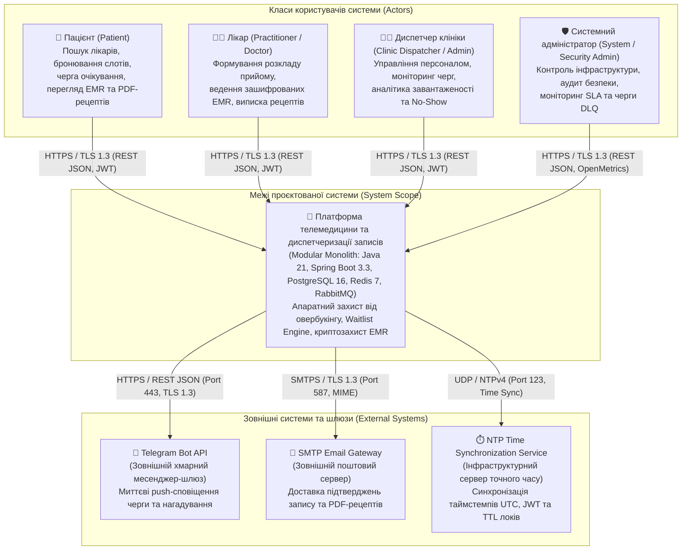
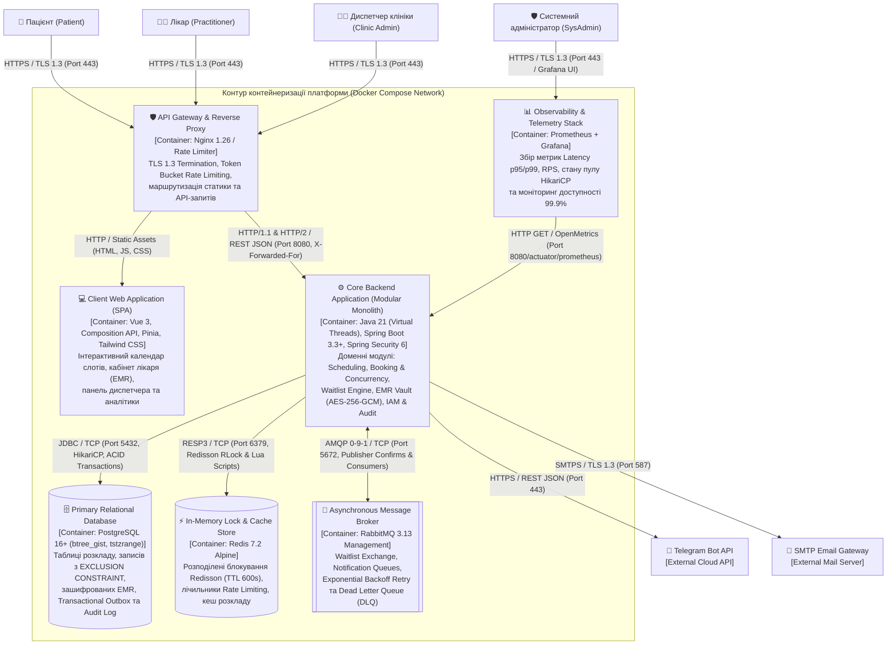

# РОЗДІЛ 2. АРХІТЕКТУРНЕ ПРОЄКТУВАННЯ СИСТЕМИ

Цей розділ визначає цільову архітектуру відмовостійкої платформи телемедицини та диспетчеризації записів за методологією **Architecture-as-Code** (ієрархічна модель **C4 Model** Саймона Брауна, рівні 1–3) на основі формалізованого інженерного контракту вимог [`srs.md`](./srs.md) (стандарт ISO/IEC/IEEE 29148) та задокументованих архітектурних компромісів у каталозі [`adr/`](./adr/0001-choice-of-technology.md).

---

## 2.1. Контекстне та контейнерне моделювання системи (C4 Model: Levels 1 & 2)

### 2.1.1. Діаграма системного контексту (C4 Level 1 — System Context Diagram)

На діаграмі системного контексту (Рівень 1) програмна платформа представлена як єдиний чорний ящик у взаємодії з чотирма класами користувачів та трьома зовнішніми інфраструктурними системами.

#### Технічна специфікація вузлів та наскрізне трасування Рівня 1 (System Context):
1. **Взаємодія користувачів із системою (`Patient`, `Doctor`, `Clinic Admin`, `SysAdmin`):**
   * Усі клієнтські звернення здійснюються виключно через захищений транспортний протокол `HTTPS / TLS 1.3` із передачею корисного навантаження у форматі `JSON` та криптографічно підписаних токенів авторизації `Bearer JWT`, що безпосередньо реалізує вимоги безпеки [`SRS-FUN-09`](./srs.md#srs-fun-09) та [`SRS-NFR-SEC-01`](./srs.md#srs-nfr-sec-01).
2. **Зовнішні інтеграційні шлюзи (`Telegram Bot API`, `SMTP Email Gateway`, `NTP Service`):**
   * Виклики до зовнішніх поштових та месенджер-шлюзів виконуються асинхронно за протоколами `HTTPS (Port 443)` та `SMTPS (Port 587)` із повною ізоляцією від основного потоку бронювання згідно з вимогами [`SRS-FUN-11`](./srs.md#srs-fun-11) та [`SRS-NFR-REL-03`](./srs.md#srs-nfr-rel-03).
   * Синхронізація системного часу за протоколом `NTPv4 (UDP Port 123)` забезпечує детерміновану точність порівняння напіввідкритих діапазонів `tstzrange` у вимозі [`SRS-FUN-01`](./srs.md#srs-fun-01) та відліку 600-секундного TTL у [`SRS-FUN-03`](./srs.md#srs-fun-03).

---

### 2.1.2. Контейнерна діаграма системи (C4 Level 2 — Container Diagram)

На діаграмі контейнерів (Рівень 2) розкрито внутрішню топологію розгортання платформи в середовищі контейнеризації **Docker Compose** ([`SRS-NFR-MAINT-02`](./srs.md#srs-nfr-maint-02)), де кожен вузол є окремим виконуваним процесом або сховищем даних.

#### Технічний опис контейнерів, протоколів та наскрізне трасування Рівня 2:
1. **`API Gateway & Reverse Proxy` (`Nginx 1.26`):**
   * *Призначення:* єдина точка входу (Single Entry Point), термінація шифрування `TLS 1.3` та первинний захист від DDoS/Brute-force атак.
   * *Трасування вимог:* забезпечує виконання транспортного захисту [`SRS-NFR-SEC-01`](./srs.md#srs-nfr-sec-01) та спільно з Redis реалізує обмеження частоти запитів [`SRS-NFR-SEC-04`](./srs.md#srs-nfr-sec-04) (не більше 60 запитів/хв з IP).
2. **`Client Web Application (SPA)` (`Vue 3 + Pinia + Tailwind CSS`):**
   * *Призначення:* реактивний клієнтський інтерфейс із розділенням маршрутів за ролями (`Patient`, `Doctor`, `Clinic Admin`), візуалізацією сітки вільних слотів та таймером зворотного відліку 10-хвилинного холду.
   * *Трасування вимог:* забезпечує користувацькі інтерфейси для вимог [`SRS-FUN-01`](./srs.md#srs-fun-01), [`SRS-FUN-02`](./srs.md#srs-fun-02), [`SRS-FUN-05`](./srs.md#srs-fun-05) та аналітичної панелі [`SRS-FUN-12`](./srs.md#srs-fun-12).
3. **`Core Backend Application (Modular Monolith)` (`Java 21 + Spring Boot 3.3+`):**
   * *Призначення:* центральний обчислювальний контейнер, що виконується на віртуальних потоках JVM (`spring.threads.virtual.enabled=true`) і об'єднує 6 ізольованих доменних модулів.
   * *Трасування вимог:* реалізує всі функціональні вимоги бізнес-логіки [`SRS-FUN-01`](./srs.md#srs-fun-01)–[`SRS-FUN-12`](./srs.md#srs-fun-12) та вимогу високої пропускної здатності [`SRS-NFR-PERF-01`](./srs.md#srs-nfr-perf-01) (500–1000 RPS).
4. **`Primary Relational Database` (`PostgreSQL 16+`):**
   * *Призначення:* персистентне ACID-сховище розкладів, медичних записів, зашифрованих карток EMR, таблиці `outbox_events` та незмінного журналу аудиту `audit_events`. Взаємодія здійснюється за бінарним протоколом `JDBC / TCP (Port 5432)` через пул з'єднань `HikariCP`.
   * *Трасування вимог та ADR:* реалізує апаратний захист від овербукінгу [`SRS-FUN-04`](./srs.md#srs-fun-04) та [`SRS-NFR-REL-01`](./srs.md#srs-nfr-rel-01) на основі архітектурного рішення [`ADR-001`](./adr/0001-choice-of-technology.md) (`tstzrange` + `EXCLUSION CONSTRAINT`), а також вимоги аудиту [`SRS-FUN-10`](./srs.md#srs-fun-10) і відновлення даних [`SRS-NFR-REL-02`](./srs.md#srs-nfr-rel-02) (`RPO <= 1 хв`).
5. **`In-Memory Lock & Cache Store` (`Redis 7.2`):**
   * *Призначення:* високошвидкісне оперативне сховище, взаємодія з яким відбувається за протоколом `RESP3 / TCP (Port 6379)` через клієнт `Redisson`.
   * *Трасування вимог та ADR:* забезпечує перший ешелон двофазного бронювання — атомарний 10-хвилинний холд слота [`SRS-FUN-03`](./srs.md#srs-fun-03) згідно з [`ADR-001`](./adr/0001-choice-of-technology.md), прискорює читання слотів [`SRS-NFR-PERF-02`](./srs.md#srs-nfr-perf-02) (`p95 <= 150 мс`) і зберігає стан кошиків Rate Limiter [`SRS-NFR-SEC-04`](./srs.md#srs-nfr-sec-04).
6. **`Asynchronous Message Broker` (`RabbitMQ 3.13`):**
   * *Призначення:* брокер черг повідомлень, що працює за протоколом `AMQP 0-9-1 / TCP (Port 5672)` із підтвердженням публікації (`Publisher Confirms`) та персистентними чергами.
   * *Трасування вимог:* забезпечує асинхронний конвеєр черги очікування [`SRS-FUN-06`](./srs.md#srs-fun-06), відмовостійку доставку сповіщень із `Exponential Backoff Retry` та `Dead Letter Queue (DLQ)` згідно з [`SRS-FUN-11`](./srs.md#srs-fun-11) і [`SRS-NFR-REL-03`](./srs.md#srs-nfr-rel-03).
7. **`Observability & Telemetry Stack` (`Prometheus + Grafana`):**
   * *Призначення:* періодичне опитування (`HTTP GET /actuator/prometheus`) метрик JVM, пулу з'єднань та гістограм затримок для контролю SLA.
   * *Трасування вимог:* забезпечує інструментальну верифікацію метрик [`SRS-NFR-PERF-01`](./srs.md#srs-nfr-perf-01)–[`SRS-NFR-PERF-03`](./srs.md#srs-nfr-perf-03) та коефіцієнта доступності `>= 99.9%` ([`SRS-NFR-REL-02`](./srs.md#srs-nfr-rel-02)).

---

## 2.2. Компонентне моделювання критичного сервісу системи (C4 Model: Level 3 — Component Diagram)

Для поглибленої декомпозиції на рівні коду (Рівень 3) обрано центральний бекенд-контейнер **`Core Backend Application (Modular Monolith)`**, а саме його найбільш навантажене обчислювальне ядро — **підсистему атомарного бронювання, диспетчеризації черги очікування та криптозахисту EMR**.

Архітектура компонентів побудована у суворій відповідності до принципів **Clean Architecture (Hexagonal / Ports & Adapters)** та **SOLID (Dependency Inversion Principle)**: вхідні контролери не мають прямого доступу до інфраструктурних репозиторіїв БД, а бізнес-ядро взаємодіє із зовнішнім світом виключно через абстрактні інтерфейси портів (Output Ports).

```mermaid
flowchart TB
    ApiGw["🛡️ API Gateway (Nginx)"]
    RabbitExt[["📨 RabbitMQ Broker"]]
    PostgresExt[("🗄️ PostgreSQL 16+")]
    RedisExt[("⚡ Redis 7")]
    PrometheusExt["📊 Prometheus"]
    NotificationExt["🌐 Telegram API / SMTP"]

    subgraph CoreBackendContainer["Контейнер: Core Backend Application (Spring Boot 3.3 / Java 21)"]
        
        subgraph InboundLayer["1. Вхідний шар та інфраструктурний захист (Inbound / Presentation & Security Layer)"]
            SecurityFilter["🔒 JwtAuthFilter & RbacRateLimitGuard<br/>[Spring Security 6 Filter + Bucket4j]<br/>Верифікація підпису JWT, перевірка ролей RBAC,<br/>контроль Rate Limiting (HTTP 401/403/429)"]
            
            ValidationAdvice["🛡️ DtoValidation & GlobalExceptionHandler<br/>[@Valid Interceptor + @RestControllerAdvice]<br/>Валідація вхідних DTO, перехоплення SQLState 23P01<br/>(Exclusion Violation) -> HTTP 409 Conflict"]

            BookingController["🌐 Booking & Waitlist REST Controller<br/>[@RestController: /api/v1/appointments]<br/>Ендпоінти тимчасового холду, фіксації бронювання,<br/>скасування візиту та запису у Waitlist"]

            EmrController["📋 EMR & Prescription REST Controller<br/>[@RestController: /api/v1/emr]<br/>Ендпоінти ведення медичних карток та експорту<br/>верифікованих PDF-рецептів"]

            AmqpConsumer["📥 Waitlist & Notification AMQP Consumer<br/>[@RabbitListener Component]<br/>Асинхронний консюмер подій вивільнення слотів,<br/>управління Retry та маршрутизація у DLQ"]
        end

        subgraph DomainApplicationLayer["2. Шар прикладної логіки та ізольованого доменного ядра (Application & Domain Core)"]
            BookingUseCase["⚙️ BookingOrchestrationService<br/>[@Service / Use Case Interactor]<br/>Координація двофазного бронювання:<br/>1) Redisson Lock -> 2) ACID Persist -> 3) Outbox Event"]

            WaitlistService["🔄 WaitlistDispatchDomainService<br/>[Domain Service]<br/>Визначення першого кандидата в черзі очікування<br/>та автоматичне переведення слота в резерв"]

            EmrCryptoService["🔐 EmrEncryption & PrescriptionService<br/>[Domain Crypto Service]<br/>Автентифіковане шифрування полів AES-256-GCM,<br/>генерація PDF та контрольного хешу SHA-256"]

            OutboxScheduler["⏱️ TransactionalOutboxRelayScheduler<br/>[@Scheduled Polling Poller]<br/>Вичитка необроблених подій із таблиці outbox_events<br/>та гарантована публікація у RabbitMQ"]

            Ports["🔌 Domain Output Ports (Interfaces)<br/>[SlotLockPort | AppointmentRepoPort | OutboxRepoPort |<br/>EmrRepoPort | AuditLogPort | EventPublisherPort]<br/>Інверсія залежностей (SOLID DIP)"]
        end

        subgraph OutboundAdaptersLayer["3. Вихідний шар інфраструктурних адаптерів (Outbound / Infrastructure Adapters)"]
            RedissonAdapter["⚡ RedissonSlotLockAdapter<br/>[@Component implements SlotLockPort]<br/>Атомарне захоплення RLock із TTL=600s<br/>та перевірка fencing token у Redis"]

            JpaBookingAdapter["🗄️ PostgresAppointmentJpaAdapter<br/>[@Repository implements AppointmentRepoPort]<br/>Hibernate 6 + Hypersistence Utils (tstzrange),<br/>обробка EXCLUSION CONSTRAINT (btree_gist)"]

            JpaEmrAuditAdapter["🔏 PostgresEmrOutboxAuditAdapter<br/>[@Repository implements EmrRepoPort, OutboxRepoPort, AuditLogPort]<br/>Атомарний запис EMR, подій outbox_events<br/>та незмінного журналу audit_events"]

            RabbitPublisherAdapter["📤 RabbitMqEventPublisherAdapter<br/>[@Component implements EventPublisherPort]<br/>Публікація подій у RabbitMQ Exchanges<br/>із механізмом Publisher Confirms"]

            ExternalGatewayClient["🌍 ExternalNotificationClientAdapter<br/>[@Component: RestClient + JavaMailSender]<br/>Відправка повідомлень у Telegram Bot API та SMTP"]

            MetricsCollector["📈 MicrometerTelemetryAdapter<br/>[@Component: MeterRegistry]<br/>Реєстрація таймерів Latency p95/p99 та лічильників<br/>відбитих колізій овербукінгу"]
        end
    end

    ApiGw -->|"HTTP/1.1 REST JSON"| SecurityFilter
    SecurityFilter -->|"FilterChain (Authenticated Principal)"| ValidationAdvice
    ValidationAdvice -->|"Validated Request DTO"| BookingController
    ValidationAdvice -->|"Validated Request DTO"| EmrController

    BookingController -->|"DI Interface Call (DTO -> Command)"| BookingUseCase
    BookingController -->|"DI Interface Call"| WaitlistService
    EmrController -->|"DI Interface Call"| EmrCryptoService

    RabbitExt -->|"AMQP 0-9-1 Push Delivery"| AmqpConsumer
    AmqpConsumer -->|"Domain Event Handling"| WaitlistService
    AmqpConsumer -->|"Dispatch Notification"| ExternalGatewayClient

    BookingUseCase -->|"Depends on Abstractions (DIP)"| Ports
    WaitlistService -->|"Depends on Abstractions (DIP)"| Ports
    EmrCryptoService -->|"Depends on Abstractions (DIP)"| Ports
    OutboxScheduler -->|"Polls & Marks Processed via Port"| Ports

    RedissonAdapter -.->|"Implements SlotLockPort"| Ports
    JpaBookingAdapter -.->|"Implements AppointmentRepoPort"| Ports
    JpaEmrAuditAdapter -.->|"Implements Emr/Outbox/Audit Ports"| Ports
    RabbitPublisherAdapter -.->|"Implements EventPublisherPort"| Ports

    BookingUseCase -->|"Records Latency & Conflict Counters"| MetricsCollector
    RedissonAdapter -->|"RESP3 / TCP (RLock TTL=600s)"| RedisExt
    JpaBookingAdapter -->|"JDBC / SQL (tstzrange, GiST)"| PostgresExt
    JpaEmrAuditAdapter -->|"JDBC / SQL (@Transactional)"| PostgresExt
    RabbitPublisherAdapter -->|"AMQP 0-9-1 (Publisher Confirms)"| RabbitExt
    ExternalGatewayClient -->|"HTTPS / SMTPS"| NotificationExt
    PrometheusExt -->|"HTTP Scrape /actuator/prometheus"| MetricsCollector
```

### Детальний технічний опис компонентів та наскрізне трасування Рівня 3:

1. **Вхідний шар безпеки та валідації (`Inbound / Presentation & Security Layer`):**
   * **`JwtAuthFilter & RbacRateLimitGuard`:** реалізує патерн *Intercepting Filter* (ланцюжок фільтрів Spring Security 6). Перевіряє криптографічний підпис JWT-токена, витягує ролі користувача (`SecurityContextHolder`) та звертається до Bucket4j/Redis для контролю лімітів запитів. Трасується до вимог [`SRS-FUN-09`](./srs.md#srs-fun-09), [`SRS-NFR-SEC-01`](./srs.md#srs-nfr-sec-01) та [`SRS-NFR-SEC-04`](./srs.md#srs-nfr-sec-04).
   * **`DtoValidation & GlobalExceptionHandler`:** забезпечує структурну валідацію вхідних JSON-об'єктів за допомогою анотацій Jakarta Bean Validation (`@NotNull`, `@Future`) та централізоване перехоплення винятків (`@RestControllerAdvice`). Якщо ядро PostgreSQL відхиляє транзакцію через порушення індексу виключення (`DataIntegrityViolationException` із SQLState `23P01`), компонент детерміновано формує відповідь `HTTP 409 Conflict` у форматі `ProblemDetail (RFC 7807)`. Трасується до [`SRS-FUN-04`](./srs.md#srs-fun-04) та [`ADR-001`](./adr/0001-choice-of-technology.md).
   * **`Booking & Waitlist REST Controller` та `EMR & Prescription REST Controller`:** тонкі контролери (*Thin Controllers*), які не містять бізнес-логіки, а лише трансформують HTTP-запити у типізовані команди для сервісів прикладного шару.

2. **Шар прикладної логіки та доменного ядра (`Application & Domain Core`):**
   * **`BookingOrchestrationService`:** реалізує головний прецедент системи — двофазне атомарне бронювання ([`SRS-FUN-03`](./srs.md#srs-fun-03), [`SRS-FUN-04`](./srs.md#srs-fun-04)) згідно з [`ADR-001`](./adr/0001-choice-of-technology.md). Спочатку через порт `SlotLockPort` встановлює 10-хвилинний холд у Redis, а при фінальному підтвердженні відкриває транзакцію `@Transactional`, зберігає запис через `AppointmentRepoPort` та в цій же транзакції реєструє подію в `OutboxRepoPort`.
   * **`WaitlistDispatchDomainService` та `TransactionalOutboxRelayScheduler`:** реалізують патерн *Transactional Outbox* ([`SRS-FUN-05`](./srs.md#srs-fun-05), [`SRS-FUN-06`](./srs.md#srs-fun-06)). При скасуванні візиту подія `SlotReleasedEvent` гарантовано потрапляє у брокер RabbitMQ, де `AmqpConsumer` викликає доменний сервіс для миттєвого переведення слота в резерв за першим пацієнтом із черги очікування.
   * **`EmrEncryption & PrescriptionService`:** інкапсулює криптографічне ядро (`javax.crypto.Cipher` у режимі `AES/GCM/NoPadding` із ключем 256 біт) для шифрування полів медичної карти ([`SRS-FUN-07`](./srs.md#srs-fun-07), [`SRS-NFR-SEC-02`](./srs.md#srs-nfr-sec-02)), автоматично викликає `AuditLogPort` для фіксації доступу ([`SRS-FUN-10`](./srs.md#srs-fun-10)) та генерує PDF-рецепти з хешем `SHA-256` ([`SRS-FUN-08`](./srs.md#srs-fun-08), [`SRS-NFR-SEC-03`](./srs.md#srs-nfr-sec-03)).
   * **`Domain Output Ports (Interfaces)`:** набір чистих Java-інтерфейсів (`SlotLockPort`, `AppointmentRepoPort`, `OutboxRepoPort`, `EmrRepoPort`, `AuditLogPort`, `EventPublisherPort`), що реалізують принцип інверсії залежностей (**SOLID DIP**) та дозволяють тестувати доменне ядро в ізоляції ([`SRS-NFR-MAINT-01`](./srs.md#srs-nfr-maint-01)).

3. **Вихідний шар інфраструктурних адаптерів (`Outbound / Infrastructure Adapters`):**
   * **`RedissonSlotLockAdapter` та `PostgresAppointmentJpaAdapter`:** конкретні інфраструктурні реалізації портів блокування та персистентності на основі рішення [`ADR-001`](./adr/0001-choice-of-technology.md). Використовують бібліотеку `hypersistence-utils` для мапінгу Java-типу `Range<ZonedDateTime>` у нативний тип PostgreSQL `tstzrange`.
   * **`RabbitMqEventPublisherAdapter` та `ExternalNotificationClientAdapter`:** забезпечують асинхронну доставку сповіщень у зовнішні сервіси `Telegram Bot API` та `SMTP` із підтримкою 3 повторних спроб (`Exponential Backoff Retry`) і маршрутизацією збоїв у `Dead Letter Queue` ([`SRS-FUN-11`](./srs.md#srs-fun-11), [`SRS-NFR-REL-03`](./srs.md#srs-nfr-rel-03)).
   * **`MicrometerTelemetryAdapter`:** інструментує методи бронювання таймерами `@Timed` та лічильниками колізій для експорту в Prometheus ([`SRS-NFR-PERF-01`](./srs.md#srs-nfr-perf-01)–[`SRS-NFR-PERF-03`](./srs.md#srs-nfr-perf-03)).

---

## 2.3. Документування архітектурних рішень (ADR) та матриця наскрізного трасування

### 2.3.1. Реєстр прийнятих архітектурних рішень (Architecture Decision Records)

Усі стратегічні архітектурні компроміси проєкту фіксуються за індустріальним шаблоном Майкла Нігардза у каталозі [`/docs/adr/`](./adr/0001-choice-of-technology.md):

* **[`ADR-001: Вибір механізму забезпечення атомарності бронювання та апаратного запобігання овербукінгу (Redis Redisson Lock + PostgreSQL Exclusion Constraints)`](./adr/0001-choice-of-technology.md)**
  * *Статус:* **Approved (Затверджено)**
  * *Резюме компромісу (Trade-off):* Відхилено песимістичні блокування БД (`SELECT ... FOR UPDATE`) через ризик вичерпання пулу з'єднань HikariCP та оптимістичні блокування / NoSQL (MongoDB) через відсутність апаратного контролю перетину неперервних часових діапазонів. Обрано дворівневу гібридну схему (`Redis 7 Redisson RLock` + `PostgreSQL 16 tstzrange EXCLUSION CONSTRAINT`), яка гарантує `0` колізій овербукінгу ([`SRS-NFR-REL-01`](./srs.md#srs-nfr-rel-01)) при `p95 Latency <= 250 мс` ([`SRS-NFR-PERF-03`](./srs.md#srs-nfr-perf-03)) ціною ускладнення ORM-мапінгу та обов'язкового використання `Testcontainers` у CI/CD.

---

### 2.3.2. Матриця наскрізного трасування вимог в архітектуру (Traceability Matrix)

*Таблиця 2.1 — Наскрізне трасування вимог SRS (ISO/IEC/IEEE 29148) у контейнери C4, компоненти коду та рішення ADR*

| Індексатор вимоги SRS | Коротка суть вимоги | Контейнер C4 Level 2 | Компонент C4 Level 3 | Пов'язаний ADR / Метод верифікації |
| :--- | :--- | :--- | :--- | :--- |
| [`SRS-FUN-01`](./srs.md#srs-fun-01), [`SRS-FUN-02`](./srs.md#srs-fun-02) | Генерація сітки слотів `tstzrange` та багатопараметричний пошук | [Core Backend](#diagram-level2), [PostgreSQL 16+](#diagram-level2) | `BookingController`, `PostgresAppointmentJpaAdapter` | [`ADR-001`](./adr/0001-choice-of-technology.md) / k6 Read Test ([`SRS-NFR-PERF-02`](./srs.md#srs-nfr-perf-02)) |
| [`SRS-FUN-03`](./srs.md#srs-fun-03) | Тимчасовий 10-хвилинний атомарний холд слота (`TTL = 600s`) | [Core Backend](#diagram-level2), [Redis 7](#diagram-level2) | `BookingOrchestrationService`, `RedissonSlotLockAdapter` | [`ADR-001`](./adr/0001-choice-of-technology.md) / Testcontainers Redis Test |
| [`SRS-FUN-04`](./srs.md#srs-fun-04), [`SRS-NFR-REL-01`](./srs.md#srs-nfr-rel-01) | Апаратне запобігання овербукінгу (`EXCLUSION CONSTRAINT`) | [Core Backend](#diagram-level2), [PostgreSQL 16+](#diagram-level2) | `BookingOrchestrationService`, `PostgresAppointmentJpaAdapter`, `GlobalExceptionHandler` | [`ADR-001`](./adr/0001-choice-of-technology.md) / 100-Thread Concurrency Test |
| [`SRS-FUN-05`](./srs.md#srs-fun-05), [`SRS-FUN-06`](./srs.md#srs-fun-06) | Черга очікування `Waitlist` та `Transactional Outbox` | [Core Backend](#diagram-level2), [PostgreSQL 16+](#diagram-level2), [RabbitMQ 3.13](#diagram-level2) | `WaitlistDispatchDomainService`, `TransactionalOutboxRelayScheduler`, `RabbitMqEventPublisherAdapter` | Outbox Pattern / Testcontainers RabbitMQ |
| [`SRS-FUN-07`](./srs.md#srs-fun-07), [`SRS-NFR-SEC-02`](./srs.md#srs-nfr-sec-02) | Польове шифрування медкарт `AES-256-GCM` | [Core Backend](#diagram-level2), [PostgreSQL 16+](#diagram-level2) | `EmrEncryption & PrescriptionService`, `PostgresEmrOutboxAuditAdapter` | NIST SP 800-38D / Crypto JUnit 5 Tests |
| [`SRS-FUN-08`](./srs.md#srs-fun-08), [`SRS-NFR-SEC-03`](./srs.md#srs-nfr-sec-03) | Експорт PDF-рецептів із хешем цілісності `SHA-256` та аудит [`SRS-FUN-10`](./srs.md#srs-fun-10) | [Core Backend](#diagram-level2), [PostgreSQL 16+](#diagram-level2) | `EmrController`, `EmrEncryption & PrescriptionService`, `PostgresEmrOutboxAuditAdapter` | GDPR Art. 9 & HIPAA / Audit Integration Tests |
| [`SRS-FUN-09`](./srs.md#srs-fun-09), [`SRS-NFR-SEC-01`](./srs.md#srs-nfr-sec-01), [`SRS-NFR-SEC-04`](./srs.md#srs-nfr-sec-04) | Stateless `JWT` автентифікація, `RBAC` та `Rate Limiting` | [API Gateway (Nginx)](#diagram-level2), [Core Backend](#diagram-level2), [Redis 7](#diagram-level2) | `JwtAuthFilter & RbacRateLimitGuard` | Spring Security Test & Postman 429 Suite |
| [`SRS-FUN-11`](./srs.md#srs-fun-11), [`SRS-NFR-REL-03`](./srs.md#srs-nfr-rel-03) | Асинхронні сповіщення з `Exponential Backoff Retry` та `DLQ` | [Core Backend](#diagram-level2), [RabbitMQ 3.13](#diagram-level2) | `AmqpConsumer`, `ExternalNotificationClientAdapter` | Toxiproxy Chaos Test (SMTP / Telegram Outage) |
| [`SRS-NFR-PERF-01`](./srs.md#srs-nfr-perf-01)–[`03`](./srs.md#srs-nfr-perf-03), [`SRS-NFR-REL-02`](./srs.md#srs-nfr-rel-02) | Навантаження 500–1000 RPS, `p95 <= 150/250 мс`, SLA `99.9%` | [Observability Stack](#diagram-level2), [Core Backend](#diagram-level2) | `MicrometerTelemetryAdapter` | Grafana k6 Load Test & Actuator Health |
